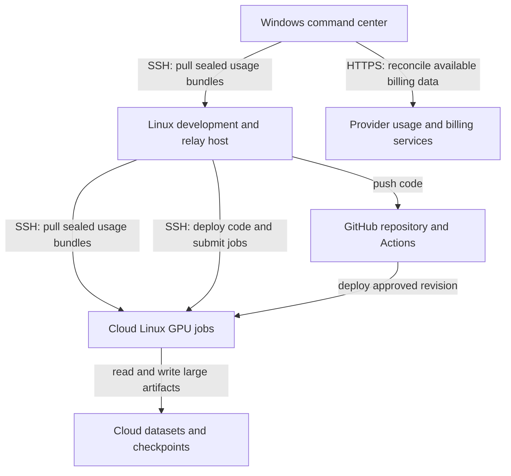

# Personal AI usage and project progress system

Design date: 2026-10-21. This document describes the target system; implementation remains future work.

## Purpose

Measure how AI tools contribute to personal projects across several machines using the same owner's accounts. Collect usage every day and produce a dashboard at the start of each week showing project token usage, spending, verified progress, and practical optimization suggestions.

Windows handles planning, presentations, reports, and email workflows. Linux handles coding, data analysis, and smaller modeling tasks. AWS, GCP, or Azure Linux GPU clusters handle large training and evaluation jobs. Large datasets, checkpoints, and detailed training artifacts stay in cloud storage.

## Architecture

Arrows for pulls show which machine initiates the connection. Usage data travels back in the SSH response. Machine communication uses SSH/SFTP; provider APIs and GitHub services use their supported HTTPS interfaces. SSH is not a substitute for those service APIs.

| Component | Responsibility | Persistent state |
| --- | --- | --- |
| Each Windows machine | Capture available agent usage and task outcomes | Private local spool and collector cursor |
| Linux development host | Capture local usage; retrieve cloud bundles; relay them to Windows | Local spool, cloud manifests, transfer receipts |
| Cloud job or coordinator | Capture agent calls, job metrics, artifact references, and final state | Durable cloud spool and run manifest |
| Windows command center | Gather all Windows and Linux bundles, validate, deduplicate, reconcile, and report | Private SQLite database, snapshots, reports |
| Reporting agent | Explain deterministic aggregates and evidence; propose optimizations | Versioned report and input references |

Additional Windows machines expose a restricted SSH/SFTP collection account for the command center to pull from. The command center also ingests its own local spool. Cloud bundles retain the original machine and event identity while passing through Linux.

## What can be measured

| Source | Collection approach | Limitation |
| --- | --- | --- |
| OpenAI API | Capture response usage and reconcile eligible organization cost reports | API records do not establish usage in every consumer application |
| Codex | Validate supported telemetry on the installed client; use a versioned local-log adapter only if needed | Event fields and client coverage must be tested |
| Claude API | Capture response usage and reconcile eligible organization usage/cost reports | Access depends on the account and permissions |
| Claude Code | Use supported OpenTelemetry export through a local collector | Telemetry costs are approximations, not billing truth |
| ChatGPT/Claude browser and desktop chats | Use supported exports or account reporting where available; otherwise record task metadata manually | Complete per-request token counts may be unavailable; label gaps |
| Self-hosted models and GPU training | Instrument inference calls and training/evaluation jobs | Dataset training tokens are distinct from agent inference tokens |

Shared login identifies an owner, not a project or machine. Every collection source needs an explicit capability record: supported usage fields, observed coverage, adapter version, and last successful collection. Do not infer exact token usage from conversation length or subscription quota percentages.

## Project identity and progress

Give every project a stable ID, such as `personal-research` or `model-evaluation`. Map local repository roots, chat/project identifiers, cloud labels, and CI jobs to that ID. A launcher can set `AI_PROJECT_ID` and a shared `run_id`; this is a convention for the collector, not a claim that every agent reads that environment variable.

Explicit launch metadata takes priority over configured workspace mappings. Conflicting mappings are flagged. Unmatched usage goes to `unassigned`, never silently to the most recently used project. Changes are recorded as audited attribution corrections.

For each task, record its objective, status, related sessions, and evidence. Examples include a commit plus passing tests, an exported presentation, a report path, a job manifest plus evaluation results, or an email delivery receipt. Writing an email draft does not prove delivery; a commit alone does not prove a feature works. The reporting agent must distinguish completed, in progress, blocked, failed, and unverified work.

## Daily operation

Proposed timezone: `Asia/Seoul`. All stored timestamps use UTC.

1. Collect locally throughout the day, preserving usage before applications close or cloud instances terminate. Seal small immutable bundles periodically and at task completion.
2. At 23:30, Linux pulls sealed cloud bundles and stages them alongside local usage. Cloud jobs flush periodically and before shutdown to storage that survives instance termination.
3. At 23:45, Windows pulls from Linux and the additional Windows machines, then ingests its local bundles.
4. At 00:15, Windows closes the previous calendar day, re-reads a rolling seven-day window for late records, reconciles available provider charges, and produces a daily ledger and collection-health result.
5. A deterministic job computes totals. An optional AI pass explains anomalies and task progress from sanitized metadata. The reporting agent's own usage belongs to `system-observability`.

Use Windows Task Scheduler and Linux systemd timers or cron. Configure a single-instance lock, retries, and a missed-run policy. An offline machine must show as stale; it must not appear to have zero usage. On wake/startup, collect overdue data and rebuild affected reports. Sealing by collection time must not discard events that arrive late or cross midnight.

## Weekly dashboard

At 08:00 Monday in Seoul, summarize the previous Monday 00:00 through the current Monday 00:00, using an exclusive end time. Pull again first. Mark the report provisional when machines or billing sources are incomplete, and version it when late data changes the result.

Each project row shows:

- Recorded input/output tokens and cache categories, with estimated usage shown separately.
- Provider-reported API charges, estimated API cost, allocated subscription cost, and cloud charges in separate columns.
- Completed milestones with evidence links, ongoing work, blockers, and failed/repeated attempts.
- Usage by machine, agent, model, and day; collection freshness and unknown coverage.
- Budget utilization, week-over-week changes, and measurement confidence.

Use a local static HTML dashboard plus Markdown and CSV exports for an initial build. Keep it local by default. Evidence links must resolve on the command center or to an authorized cloud/GitHub resource; a Linux-only path is not sufficient.

Suggestions should connect evidence to an action: reduce repeated context, reuse a reviewed project brief, move suitable tasks to a cheaper model, stop repeated failing loops, reuse cached inputs where supported, or use smaller evaluation samples before full runs. Include the observed pattern, proposed experiment, estimated savings with assumptions, and a quality check. Token savings are useful only when task quality remains acceptable. Do not automatically change models, budgets, deployments, or cloud capacity.

## Cost boundaries

Maintain separate ledgers for API usage, subscriptions, and cloud compute/storage/network charges. Also keep training tokens and inference tokens separate. Model inference on self-hosted GPUs can have zero provider token charges while still generating substantial infrastructure costs.

For subscription tools, record the actual subscription fee once per billing period. Any project share is an allocation under an explicit policy, not the provider's measured charge for that project. Leave unmeasured activity unallocated instead of presenting partial telemetry as complete. API-equivalent estimates, if useful, are counterfactual comparisons and never enter actual-spend totals.

Cloud job runtime estimates are provisional. Reconcile them to billing exports and preserve shared/idle capacity costs as unallocated unless a documented rule assigns them. Avoid counting managed-model charges in both the API and cloud ledgers. Retain original currency; currency conversion requires a dated rate.

## Storage, access, and recovery

Store the live database and private data under `%LOCALAPPDATA%\using_ai_better`, outside OneDrive. This repository can remain in the requested OneDrive folder. Use encrypted backups of consistent database snapshots and test restoration.

Use dedicated SSH collection keys, pinned host keys, restricted read access, and no agent forwarding. Avoid giving the reporting agent shell access to raw transcripts or cloud data. Export only allowlisted metadata by default. Keep API/admin credentials in OS or cloud secret storage and never in bundles or Git. Treat log text as untrusted input that cannot instruct the reporting agent to execute commands or send messages.

Initial retention policy: sanitized source bundles for 30 days, normalized usage and progress metadata for 12 months, and aggregate reports for 24 months. Apply the same expiry to backups and document exceptions.

## Implementation sequence

1. Establish project IDs, source capabilities, local storage, and fixtures on Windows and Linux.
2. Build one agent adapter, immutable bundle transport, deterministic ingestion, and a daily CSV report.
3. Add reconciliation, progress evidence, a weekly dashboard, and measured reporting-agent usage.
4. Add cloud run manifests, termination-safe export, billing imports, and CI attribution.
5. Add further providers and machines only after the acceptance checks in the [reusable specification](REPLICATION_SPEC.md) pass.

## Verified source references

Checked 2026-10-21. Product interfaces and access rules can change; validate installed clients during implementation.

- [OpenAI Costs API](https://developers.openai.com/api/reference/resources/admin/subresources/organization/subresources/usage/methods/costs): organization cost reports and project grouping.
- [Codex configuration reference](https://learn.chatgpt.com/docs/config-file/config-reference) and [advanced configuration](https://learn.chatgpt.com/docs/config-file/config-advanced): supported telemetry configuration; confirm actual events before depending on a field.
- [Claude Code monitoring](https://code.claude.com/docs/en/monitoring-usage): OpenTelemetry usage metrics and approximate cost reporting. Claude input telemetry excludes cache reads/writes, which require explicit normalization.
- [Claude Usage and Cost API](https://platform.claude.com/docs/en/manage-claude/usage-cost-api): organization API usage/cost reporting and required administrative access. Consumer subscriptions are not assumed to have equivalent access.
